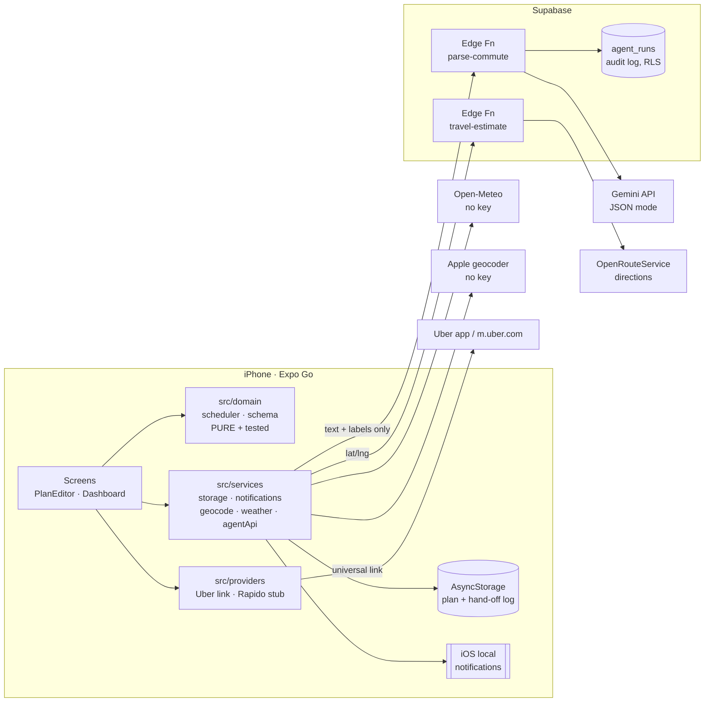

# Architecture — Commute Agent

## 1. System overview

## 2. Components

| Layer | Files | Responsibility |
|---|---|---|
| Screens | `src/screens/OnboardingScreen.tsx`, `DashboardScreen.tsx`, `App.tsx` | 4-step onboarding (tell the agent → pickup pin → drop-off pin → schedule); dashboard with map hero, countdown, timeline, agent chips, week strip, test reminder; notification-tap handler |
| Components | `src/components/*` | `PlacePicker` (search / GPS / draggable pin), `RouteMap`, `TimelineBar`, `TimeStepper`, `Segmented` |
| Domain (pure) | `src/domain/scheduler.ts` | Leave/book time maths, rush-hour & rain adjustments, working-day / skip / override logic, weekday mapping, plain-language explanation |
| Domain (pure) | `src/domain/schema.ts` | Zod schema for LLM output (`.strict()`), business-rule validation, `applyIntent` reducer |
| Providers | `src/providers/*` | `RideProvider` interface. Uber = `prefill_handoff` using documented link. Rapido = `unsupported` |
| Services | `src/services/*` | Side effects: AsyncStorage, expo-notifications, expo-location geocoding, Open-Meteo, Edge Function calls, `Linking.openURL` |
| Backend | `supabase/functions/parse-commute` | Calls Gemini with a versioned system prompt; JSON mode; temperature 0; logs to `agent_runs` |
| Backend | `supabase/functions/travel-estimate` | Calls OpenRouteService directions; returns minutes + km |
| DB | `supabase/migrations/*_agent_runs.sql` | Audit log; RLS on, no policies → only service role can write/read |

## 3. Key data flows

**A. Setup by sentence**
1. User types "Mon–Fri Vijay Nagar se Crystal IT Park, 9:30 tak".
2. `agentApi.parseCommand` → Edge Fn `parse-commute` (text, today, weekday, current labels/times — no coordinates).
3. Gemini returns JSON → Edge Fn logs it → app re-validates with `validateAgentOutput`.
4. Valid → fields are pre-filled; invalid → error shown, nothing changes.
5. Pickup and drop-off are each confirmed on a map: the agent's address is geocoded (Apple, no key), the user
   drags the pin to the exact gate (or uses GPS). Only then **Start my commute** saves the plan locally.

**B. Daily planning**
1. Dashboard fetches route minutes (`travel-estimate`) and rain probability (Open-Meteo) for the next commute.
2. `upcomingPlans()` computes the next 14 commute days:
   `travel = base × 1.3 (rush hour 8–11, 17–21) + 10 if rain ≥ 60%`;
   `leaveBy = arrive − travel − buffer`; `bookAt = leaveBy − driverWait`.
   No estimate → 30 min default, clearly labelled.
3. `syncReminders()` cancels and re-creates one-off DATE notifications for those 14 days — a "Book now" at bookAt and
   a "Leave now" at leaveBy (28 total, iOS limit 64).

**C. Hand-off**
Reminder tap or button → `buildUberLink()` →
`https://m.uber.com/ul/?action=setPickup&pickup[latitude]=…&pickup[longitude]=…&pickup[nickname]=…&pickup[formatted_address]=…&dropoff[…]`
→ `Linking.openURL`. iOS opens the Uber app if installed, else Uber mobile web. The app records
"Opened Uber" — never "booked".

**D. Change by chat**
"kal chhutti hai" → intent `skip_dates` `["2026-10-29"]` → preview card → **Apply** → `applyIntent`
(pure) → saved → upcoming + reminders recomputed.

## 4. Technology stack

| Concern | Choice | Why |
|---|---|---|
| App | Expo SDK 58, React Native 0.88, TypeScript strict | Runs in Expo Go on a real iPhone — no paid Apple account or native build |
| UI | Liquid Glass (`expo-glass-effect`, fallback `expo-blur`), SF Symbols, gradients, haptics | Native iOS 26 look; all modules ship in Expo Go |
| Maps | `react-native-maps` → Apple Maps | Free, no API key, in Expo Go (MapLibre/expo-maps need a dev build — D-011) |
| State/storage | React state + AsyncStorage | Single user, single device; privacy by default |
| Validation | Zod | Same schema guards LLM output and is unit-tested |
| LLM | Gemini (free tier), JSON mode, temp 0 | Free, no card; JSON mode reduces malformed output |
| Routing | OpenRouteService (free key) | Google Routes requires billing; ORS free tier is enough |
| Weather | Open-Meteo | No key, no signup |
| Geocoding | Apple via `expo-location` | No key |
| Backend | Supabase Edge Functions (Deno) + Postgres | Keeps secrets server-side; free tier |
| Tests | Jest (`jest-expo`), custom LLM eval runner | Domain logic + LLM behaviour |

## 5. Security & privacy
- Secrets only in Supabase secrets; app holds the public anon key.
- LLM receives user text + labels/times, not coordinates.
- `agent_runs` has RLS enabled with no policies (anon cannot read the log).
- Edge Functions validate input size (≤ 500 chars) and coordinate ranges.
- Commute plan and history never leave the phone except as described above.

## 6. Key technical decisions
See `docs/DECISIONS.md` (D-001 … ). Summary: LLM for language only; documented Uber link only;
Rapido unsupported; local DATE notifications instead of background jobs; ORS + rush-hour factor
instead of paid traffic APIs; on-device storage instead of accounts.

## 7. Future architecture
- Authorised booking: add `requestRide()` to `RideProvider` for a provider/business API; keep planning unchanged.
- Server-side scheduling: Supabase cron + push notifications for live traffic re-checks (needs a dev build).
- Accounts + sync (Supabase Auth) and a B2B admin view.
